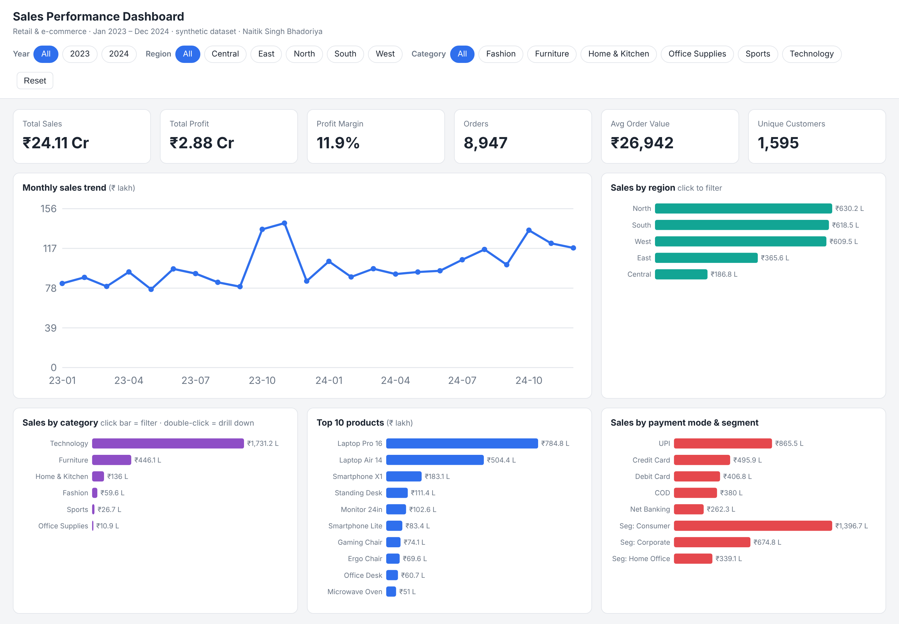

# Sales Performance Dashboard

End-to-end data-analyst project: **Python cleaning → Oracle SQL star schema → Power BI dashboard**.
HCL × NASSCOM B.Tech 2nd Year – Data Analyst track · **Project No. 1 – Retail and e-commerce**

| | |
|---|---|
| **Student** | Naitik Singh Bhadoriya |
| **Roll No.** | 25003215410104 |
| **Tools** | Python (pandas), Oracle SQL / PL-SQL, Power BI Desktop |



## Highlights
* 15,610 dirty raw rows → **15,181 clean rows**, 0 nulls, 0 duplicates, 0 orphan keys
* Total sales **₹24.11 Cr** (₹241,053,486.78), reconciled across CSV, Oracle SQL and Power BI (difference 0.00 % vs 0.1 % allowed)
* 8 KPIs, 3+ slicers, category → sub-category → product drill-down
* **22/22** automated SQL-vs-pandas validation checks pass
* Key finding: discounts above 20 % turn margin negative (−1.7 %); Oct–Nov give 22 % of yearly sales

## Repository structure
```
├── data/raw/retail_sales_raw.csv         dirty source (synthetic, seed 42)
├── data/clean/                           star schema CSVs + flat file
├── data/powerbi/                         same CSVs, load folder for Power BI
├── python/                               01 generate · 02 clean · 03 validate SQL · 04 dashboard · 05 ER diagram
├── sql/                                  Oracle: 01 DDL · loader/*.ctl · 03 views · 04 queries · 05 reconciliation · 06 PL/SQL check
├── powerbi/                              POWERBI_BUILD_GUIDE.md (steps + DAX) · theme · put the .pbix here
├── dashboard/                            sales_dashboard.html (open in browser) + screenshots
├── reports/                              data-quality report · insights · reconciliation · SQL validation · rejected rows
├── docs/                                 problem statement & KPIs · ER diagram · test cases
└── demo/                                 demo video script (+ walkthrough video)
```

## How to run
```bash
pip install -r requirements.txt
bash run_all.sh                 # or run python/01 … 05 one by one
```
**Oracle:** run `sql/01_create_tables.sql`, load CSVs (`sql/02_load_data.md`), then `03_views.sql`, `04_analysis_queries.sql`, `05_reconciliation.sql`.
**Power BI:** follow `powerbi/POWERBI_BUILD_GUIDE.md`.
**Quick look without any tool:** open `dashboard/sales_dashboard.html` in a browser.

## Data note
The dataset is **synthetic** (Kaggle-Superstore-style) with deliberately injected quality problems so the cleaning rules are demonstrable. The pipeline is column-compatible with real retail CSVs.

## Deliverables checklist
- [x] Problem statement & KPI definitions – `docs/01_problem_statement_and_kpis.md`
- [x] ER / star-schema diagram – `docs/er_star_schema.png`
- [x] Python cleaning script – `python/02_clean_sales.py`
- [x] Oracle SQL scripts (DDL, load, queries, views) – `sql/`
- [x] Power BI dashboard (.pbix) – build with `powerbi/POWERBI_BUILD_GUIDE.md`
- [x] Data-quality report – `reports/data_quality_report.md`
- [x] Insights summary – `reports/insights_summary.md`
- [x] README · GitHub repository · demo video (`demo/dashboard_walkthrough.mp4` + script; record your voice-over with `demo_video_script.md`)
